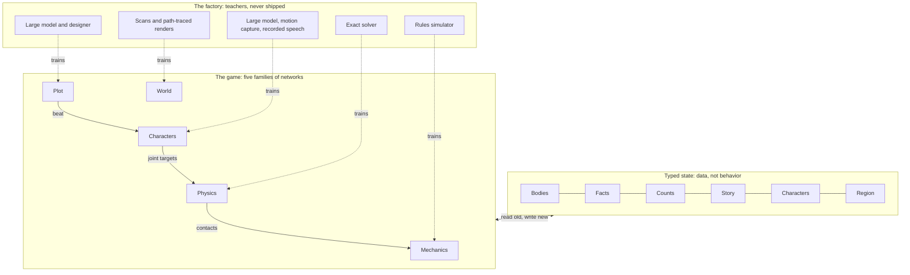

# The Living World Engine: architecture and build strategy

This page is the architecture. The specifications are separate pages:
[Spec 1: Types and state](spec-1-types-and-state.md),
[Spec 2: The tick](spec-2-the-tick.md),
[Spec 3: The networks](spec-3-the-networks.md),
[Spec 4: The factory](spec-4-the-factory.md) and
[Spec 5: Browser runtime](spec-5-browser-runtime.md).
The code is in [`engine/`](../../engine/README.md), which says what is built so far.

## The idea in one page

The game is a neural world model built from parts. The mechanics, the physics, the plot, the world and the characters in it are all neural networks, and nothing else decides what happens. A large world model is one enormous network that dreams the whole game at once. This is many small networks, one family per part of the game, joined through typed connections so that together they are one coherent, complete game.

Why parts beat one big model:

- **Quality.** Each small network has one job and a teacher for exactly that job, so it can be very good at it.
- **A world that persists.** State is named and typed between the parts. A dropped sword stays dropped, because it is a value in the state and not a memory of recent frames.
- **Safety by type.** A part can only hand on a value of the type the next part accepts. An illegal result cannot be expressed.
- **Cost.** Small networks are batched arithmetic. The whole game runs in a Chrome tab on an 8 GB laptop.
- **Change.** A part can be trained, tested and replaced on its own.

The target is Chrome, with every network written in TypeGPU on WebGPU. "Living World Engine" is a working name.

## Against one large world model

The difference from a large world model is factoring: the same all-network idea, cut along the natural parts of a game.

|  | One large world model | This design |
| --- | --- | --- |
| What it is | One network predicting the next frame | Many small networks, one family per part of the game |
| Memory of the world | Implicit in recent frames, so it drifts | Explicit typed state that every part reads and writes |
| Rules | Learned loosely and breakable | Carried by types, so an illegal result cannot be expressed |
| Quality | One model's capacity spread over everything | Each part trained against its own teacher |
| Hardware | A large GPU | A laptop, in a browser tab |
| Changing the game | Retrain everything | Retrain one part |

No hand-written solver and no large language model runs in the game. Exact solvers and large models appear only as teachers.

From the source spec, four things are kept: an all-network runtime, small models, a typed bus between them, and training each model against a better teacher. Five things are changed.

- Sizes are set by the job, from kilobytes to tens of megabytes, not by what fits in a GPU cache.
- The frame target is 60 a second, not 540.
- The whole game is hundreds of megabytes, not 20.
- The hardware path is WebGPU in a browser.
- Stability comes from training the parts together on recorded play, not from forcing every connection to damp errors.

## Principles

Seven ideas decide every later choice.

1. **Everything that happens is computed by a network.** No scripts, no hand-written solver and no pre-written lines run in the game.
2. **One family of networks per part of the game.** A part is small enough to have a clear input, a clear output and a clear teacher.
3. **Parts meet only through types.** Every value passed between parts has a declared type. If two parts disagree, the build fails.
4. **Types carry the guarantees.** The last layer of each network produces a value of its output type by construction, so it cannot emit anything else.
5. **State is data, not behavior.** The typed state is what the networks read and write. It holds the world between ticks.
6. **Large models and exact solvers are teachers, never parts.**
7. **Every connection is recorded.** Any part can be replayed offline against real play, and those recordings are the training data.

## System map

The game is five families of networks reading and writing one typed state.

Every box in the middle row is networks and nothing else. The state above them is data. The teachers below them never ship.

## Types: the state and the connections

Types are what turn many small networks into one coherent game. The typed state is everything that exists between ticks, and it has four parts.

- **Bodies and places.** Position, velocity, shape code and material code for every thing in the world.
- **Facts and counts.** Who owns what, who is alive, how much of each thing. These are whole numbers and yes-or-no flags, never approximations.
- **Story position.** Which beats have happened and which can happen now.
- **Character states.** Each character's identity, voice and style codes, memory, mood and current intent.

A save is the typed state plus the version of every network. Loading it on the same machine replays the same world.

### How types give guarantees

There are three kinds of type. Each has a last layer that cannot produce anything outside it.

- **Choice types.** The value is one of a listed set: the story beats allowed right now, the actions open to a character, the item being handed over. The network scores the options and the best one wins. An option that is not on the list cannot be chosen.
- **Count types.** Facts and counts change only through typed moves, such as "move one of this item from her to him". The network chooses the move, and applying it is whole-number arithmetic. Gold cannot drift and an item cannot be in two places.
- **Bounded types.** Positions, forces and energies pass through a final layer that pulls them into their allowed range: outside solid objects, within a strength limit, never adding energy.

Applying a typed value to the state is data plumbing, not behavior. Every decision about what the value should be is made by a network.

### Written once, checked by the compiler

Each type is a [TypeGPU](https://docs.swmansion.com/TypeGPU/) schema, and the same schema describes the data on the CPU and on the GPU. Each network is a typed function from input schemas to output schemas. Connect two parts whose types disagree and the TypeScript compiler rejects the build, before anything runs.

| Connection | From, to | Type |
| --- | --- | --- |
| Perception | State to Characters | What each character can see and hear this tick |
| Intent | Character mind to character body | Goal, velocity, facing, a choice of action, urgency, mood |
| Joint targets | Character body to Physics | Bounded angle and stiffness per joint |
| Contacts | Physics to Mechanics, sound and Characters | Bodies, point, direction, impulse |
| Fact moves | Mechanics to state | Typed moves over facts and counts |
| Beat | Plot to Characters | A choice among allowed beats, plus who plays it and where |
| Utterance | Character speech to voice | Word pieces, with facts and names as references into the state |
| Surface | World to light | Shape and material at each visible point |

### The trace recorder

Every value crossing a connection goes into a ring buffer and, when asked, to disk. Any single network can then be run offline against a recorded session. That one tool gives bug reproduction, regression checks and training data from real play.

## The networks, by part of the game

There are five parts, and each is a small family of networks. The sizes are estimates of what each job needs. None is measured yet.

| Part | Its networks | Teacher | Rough size |
| --- | --- | --- | --- |
| Mechanics | Outcome network: what an action or a contact does to facts and counts | A reference rules simulator, plus cases written by the designer | Under 1 MB |
| Physics | Step network; cloth and soft detail; impact sound | An exact solver run at tiny time steps; a vibration solver | 1 to 5 MB |
| Plot | Director: which beat comes next and who plays it | A large model and the designer judging thousands of play-throughs | Under 1 MB |
| World | Shape and surface; light; weather and time of day | Authored or scanned scenes; path-traced renders | 10 to 100 MB a region, mostly scene data |
| Characters | Mind, memory, speech, voice, body, face | A large model playing every character; motion capture; recorded speech | 30 to 100 MB |

### Mechanics

The rules of the game are a network. It reads what just happened, such as a blade's impulse on armor, a hand closing on a purse or a spoken agreement, and outputs typed moves on facts and counts: damage dealt, item transferred, crime recorded.

Its teacher is a rules simulator that exists only in the factory. Because its outputs are typed moves, it can misjudge how hard a blow landed, but it cannot create gold or duplicate an item.

### Physics

A step network advances every body one tick, contacts included. It works in three stages: a contact stage reads two shape codes and their relative pose and gives distance and direction; a message-passing stage shares impulses among touching bodies; a bounded last layer removes any overlap and any added energy.

Companion networks add what the step network leaves coarse. One adds cloth folds and soft-tissue motion. One gives every struck object its ringing tones from shape and material, so each contact makes its own sound.

### Plot

The plot is a network that reads the story position and the state of the world, then chooses the next beat and its cast. Its output is a choice type, so only beats whose conditions hold are on the list.

The source's example is the model case. A killing changes a fact. That makes the recruitment beat allowed. The director gives it to the hooded stranger already sitting in the tavern, because the scene suits it.

### World

The place is networks too. A shape-and-surface network holds each region as a fitted field of small elements that the GPU draws directly. A light network gives every visible point its color under the current sun, torches and weather.

WebGPU has no hardware ray tracing and no mesh shaders. That suits this part, which draws with plain rasterizing and compute and gets its lighting from a network.

### Characters

All characters share one family of networks. A character is a row of typed state: identity code, voice code, style code, memory and mood. The networks are how people in this world think, speak and move. The state is who each one is.

That is why every character is fully present all the time. One more character is one more row in each batch.

- **Mind.** A small recurrent network turns perception, memory and the current beat into intent. It runs a few times a second for everyone at once.
- **Memory.** A small fixed table in each character's state, written by the mind. When two characters talk, rows copy from one to the other, weaker. That is how rumor travels.
- **Speech.** A small language network trained only on this world's speech. It turns identity, mood and what the character means to convey into words. Names and facts enter as references into the state, so it cannot state something the state does not hold.
- **Voice.** A small speech network turns the words and a voice code into sound, with the timing of each speech sound.
- **Body.** A controller network turns intent into joint targets, and the physics network carries them out. A style code makes a guard move unlike a thief.
- **Face.** A small network turns voice timing and mood into expression.

Two published results suggest the speech and voice networks can be this small. Language models under 10 million parameters write fluent, consistent multi-paragraph stories when trained on a narrow world ([TinyStories](https://arxiv.org/abs/2305.07759)). An open speech model with 15 million parameters fits in 25 MB ([Kitten TTS](https://github.com/KittenML/KittenTTS)). Physical controllers that follow sparse goals on unseen terrain exist in research ([MaskedMimic](https://research.nvidia.com/labs/par/projects/maskedmimic/)).

## What ships

The game is its networks plus a starting state. Nothing general-purpose ships: no large language model, no physics library, no script engine. Sizes are estimates.

| Piece | Rough size |
| --- | --- |
| Mechanics, physics and plot networks | Under 10 MB |
| Character networks: mind, speech, voice, body, face | 30 to 100 MB |
| World: scene data and light network | 10 to 100 MB a region |
| Starting state: every character's codes, the facts, the story graph | A few MB |

The whole game comes to a few hundred megabytes. The networks and the first region load first and play begins. Other regions stream in behind and are cached by the browser.

A different game on the same engine is a different set of trained networks and a different starting state. The types, the runtime and the factory are reused.

## Runtime: one tick

Every network runs as a batch: one row per character, per body or per pixel. A tick is the same seven phases every time. [Spec 2](spec-2-the-tick.md) gives the detail.

1. **Perceive.** Each character's view of the world is gathered from the state.
2. **Characters.** Minds update intent. Speech emits the next word piece for everyone who is talking. Bodies emit joint targets.
3. **Physics.** The step network advances every body and reports contacts.
4. **Mechanics.** The outcome network turns contacts and actions into typed moves on facts and counts.
5. **Plot.** The director chooses a beat when the story position allows one.
6. **Commit.** The moves and the chosen beat are applied to the state. No network runs here.
7. **Draw.** Shape, surface and light are drawn. Voice and impact sound go to the audio thread.

Minds and the director run a few times a second. The rest run every frame.

### Why the load stays light

The cost of one evaluation is roughly one multiply per weight. This is arithmetic, not measurement.

- Speech: 30 million weights, 20 characters talking, 15 word pieces a second. About 9 billion multiplies a second.
- Minds: 200 thousand weights, 1,000 characters, 4 times a second. Under 1 billion.
- Bodies: 2 million weights, 100 characters, 30 times a second. About 6 billion.
- Physics: about 50 thousand weights per touching pair, 5,000 pairs, 60 times a second. About 15 billion.

That is about 30 billion multiplies a second for everything except drawing. A base Apple silicon GPU is rated at over a trillion operations a second (a remembered figure, to be confirmed), so the margin is large even after real-world losses. Drawing the world is the biggest cost in the frame.

### Budgets

These are design targets for 60 frames a second in Chrome on a base Apple silicon laptop. They are what to measure against, not predictions.

| Share of a 16.6 ms frame | Target (ms) |
| --- | --- |
| Characters: mind, speech, body, face | 2.0 |
| Physics | 2.5 |
| Mechanics and plot | 0.3 |
| World: shape and surface | 5.0 |
| World: light | 4.0 |
| Voice, sound and headroom | 2.8 |

Memory is not a constraint at this size. Networks take 0.1 to 0.3 GB, scene data and buffers under 1 GB, so the tab stays near 1.5 GB on an 8 GB machine.

### Three browser facts

- **Buffers have ceilings.** WebGPU guarantees only 256 MB per buffer unless more is requested and granted ([measured notes](https://pinggy.io/blog/run_llm_in_browser_webgpu/)). Ask for limits at start-up and split scene data to fit.
- **Shaders compile on first use.** Build every network's pipeline during loading, in the background, so the first sword swing does not hitch.
- **Optional features vary by machine.** Chrome offers half-precision numbers and features that let neighbouring shader threads share work, but grants them per device. Request them at start-up and keep a plain 32-bit path.

Every network is written directly as a TypeGPU compute function. No model runtime library is needed.

## The factory: how the networks are made

The factory is where everything large and exact lives. It turns the designer's canon into small trained networks, and none of its tools ship.

| Part | What the factory does |
| --- | --- |
| Mechanics | Runs a rules simulator over millions of situations and trains the outcome network to match its typed moves |
| Physics | Solves the same scenes with an exact solver at tiny time steps and trains the step network on the results |
| Plot | Has a large model and the designer score thousands of simulated play-throughs, and trains the director toward the high scores |
| World | Fits each region from authored or scanned scenes, and trains the light network on path-traced renders |
| Characters | Has a large model play every character across many thousands of situations for mind and speech; uses motion capture for bodies and recorded speech for voice |

Parts trained alone fail when joined, because each has only seen perfect inputs. Four steps fix that.

1. Train each network alone against its teacher.
2. Run the whole game, record every connection, and retrain each network on what its neighbors really send. Repeat until the recordings stop changing much.
3. During training, add noise shaped like each neighbor's measured error.
4. Where a network's output feeds back into its own input, as with body and physics, train on many ticks in a row.

Types help here as well. A typed output gives each network an exact target, and a typed input tells the factory exactly what to vary.

Two measurements are worth making early.

- **Where the errors point.** For each connection, compare what a network sent with what its teacher would have sent. If the difference concentrates in a few directions, hardening the next network is cheap.
- **Whether speech obeys the state.** Flip one fact, regenerate a few thousand lines, and count the lines that still state the old fact. With facts entering as references it should be zero, and this test proves it on every new version.

The game's shader code also runs outside the browser on native WebGPU implementations, so the factory can run the whole game headless on a server. How much GPU time the factory needs has not been measured. The character and physics networks will take the most.

## Build order

Build the whole loop first with stand-in networks, then replace them one part at a time. The game is complete from the first week and gets better part by part.

1. **Types and a full tick.** Write the schemas, the state and the recorder. Put a tiny stand-in network in each of the five parts so one whole tick runs in Chrome on an 8 GB laptop. This proves the parts compose and the types hold.
2. **A room.** Train the world networks for one interior and draw it.
3. **People who think and talk.** Train mind, speech and voice for a dozen characters in that room, all speaking at once. This is the first test of how small the speech network can be.
4. **Rules.** Train the outcome network on a small rule set: take, give, pay, strike.
5. **Things that move.** Train the step network on clutter, then on jointed bodies, with impact sound.
6. **Bodies.** Train the controller on top of the physics network: walk, recover from a shove, then fight.
7. **A story.** Train the director over a small story graph.
8. **The factory as a product.** Canon goes in, networks come out. Then make a second small game to prove the engine is reusable.

Stages 2 to 5 can run side by side once stage 1 exists, because the types fix every boundary in advance.

## In the browser

The game is a web page in Chrome. It needs four pieces of the web platform and no engine underneath.

| Need | Web piece | Note |
| --- | --- | --- |
| Every network, and drawing | [TypeGPU](https://docs.swmansion.com/TypeGPU/) on WebGPU | Networks are TypeScript functions over typed buffers. TypeGPU is on its 0.12 line, before a 1.0 release, so pin the version |
| The types | TypeGPU schemas | One definition describes the data on the CPU and the GPU, and the compiler checks every connection |
| State plumbing and the recorder | TypeScript and WebAssembly in worker threads | Shared-memory threads need the site to send cross-origin isolation headers |
| Sound out | An audio worklet | Keeps audio off the page's main thread |

With everything as small batched networks, the engine asks the browser for the thing it is best at, parallel arithmetic, and avoids the things it lacks. The download is a few hundred megabytes and memory is not a concern on 8 GB.

Three limits remain.

- **No hardware ray tracing or mesh shaders.** WebGPU has neither today. Ray queries were proposed to the standards group in October 2026 and are still under discussion ([activity log](https://www.w3.org/groups/cg/gpu/activity/2026/)). The world part is designed without them.
- **Laptops throttle.** Heat and battery mode cut GPU speed. Budgets should hold on battery.
- **Chrome only, for now.** Other browsers come later and will differ in optional features.

## Open bets

The design is settled: everything is a network, cut by part of the game, joined by types, running in Chrome on 8 GB. Six things are still bets, and each has a first experiment.

- **How small speech can be.** Small language networks are fluent in narrow worlds. Whether 30 million weights can carry a whole cast with distinct voices is unproven. Measure quality against size before anything else in the characters part.
- **Learned contact.** Contact is abrupt, and stacks of resting objects are the hard case. The bounded last layer prevents overlap and runaway energy. It does not make a tall stack sit still.
- **Many physical bodies.** Research controllers handle one body well. Dozens fighting in one room on a laptop has not been shown.
- **The world as networks.** Fitted scenes look right from the viewpoints they were fitted to. Moving light and moving characters inside them are harder.
- **Rules that are right, not just legal.** Types make every outcome legal. They do not make it correct. The outcome network can still misjudge a blow, so its accuracy needs its own measure.
- **Staying stable together.** Training parts on each other's real outputs is the answer. It is unproven across this many parts at once.

Story quality over long play also needs watching. The director can only choose allowed beats, but allowed is not the same as good.

## Sources

Pages opened for this document on 9 and 10 November 2026. Everything not linked here is design judgment.

- [TypeGPU documentation](https://docs.swmansion.com/TypeGPU/), Software Mansion
- [TinyStories: How Small Can Language Models Be and Still Speak Coherent English?](https://arxiv.org/abs/2305.07759), arXiv, 2023
- [Kitten TTS](https://github.com/KittenML/KittenTTS), small open speech models
- [MaskedMimic](https://research.nvidia.com/labs/par/projects/maskedmimic/), NVIDIA Research, SIGGRAPH Asia 2024
- [Run an LLM Inside a Browser Tab](https://pinggy.io/blog/run_llm_in_browser_webgpu/), Pinggy, September 2026: WebGPU buffer limits
- [GPU for the Web Community Group, activity in 2026](https://www.w3.org/groups/cg/gpu/activity/2026/), W3C

