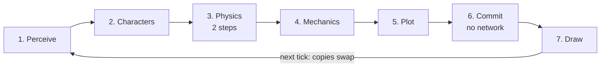

# Spec 2: The tick

This spec defines the order in which networks run, what each may read and write, and how a tick is recorded and replayed. The code is [`engine/src/tick.ts`](../../engine/src/tick.ts), [`engine/src/commit.ts`](../../engine/src/commit.ts), [`engine/src/recorder.ts`](../../engine/src/recorder.ts) and [`engine/src/rng.ts`](../../engine/src/rng.ts).

The phases never reorder. Networks that run less often than every tick simply skip their turn.

## Phases in order

A tick is one sixtieth of a second and always runs the same seven phases. Six run networks. One, the commit, applies typed values and runs none.

| Phase | Networks | Reads | Writes | Rate |
| --- | --- | --- | --- | --- |
| 1. Perceive | Perception | Body, Character | What each character sees and hears | Every tick |
| 2. Characters | Mind, memory, speech, body, face | Perception, Character, the current beat | Intent, carried states, word pieces, joint targets, face weights | Mind 4 a second; speech 15; body 30; face 60 |
| 3. Physics | Contact, impulse, bound, detail, sound | Body, joint targets | Body, Contacts, sound tones | 2 steps a tick |
| 4. Mechanics | Outcome | Contacts, chosen actions, Counts, Facts | Moves | Every tick, one row per event |
| 5. Plot | Director | Story, Facts, character summaries | A beat and who plays it | 2 a second |
| 6. Commit | None | Moves, the chosen beat | Counts, Facts, Story | Every tick |
| 7. Draw | Scene field, light, weather | Body, Region | The frame | Every displayed frame |

Networks that run less often than every tick are spread out. Minds run for one fifteenth of the characters each tick, so every character thinks 4 times a second and the cost per tick is flat.

The voice network runs beside the tick. Every fourth tick it produces the next stretch of audio for each speaking character and hands it to the audio thread.

## Buffers, batching and the order of writes

Every state table exists twice: the copy being read, and the copy being written. That is what lets every row of a batch run at once.

- **Read old, write new.** Within a phase, every network reads the current copy and writes the next copy. The copies swap at the end of the tick.
- **One row, one writer.** A network row writes only its own output row. Anything that combines rows, such as summing impulses on a body, gathers from a list sorted in the phase before.
- **One dispatch per network.** A network runs as a single compute dispatch over all its rows, with its weights in one read-only buffer.
- **Moves are applied in a fixed order.** Before the commit, moves are sorted by taker, then kind, then giver, then item. Two moves that claim the same item are resolved by that order: the first applies and the second is void.
- **The allowed set is plumbing.** After the commit, each beat's required facts are compared with the Facts table by bit operations. That produces the mask the director's Choice uses on the next tick.

## Repeatability and random numbers

The same build on the same machine and browser version replays a recorded session exactly. Different GPUs may differ in the last digits of a float, so exact replay across machines is not promised.

- **Fixed order.** Phases, rows and moves always run in the order above.
- **Counted randomness.** A random number is a hash of the seed, the tick, the row and a stream number. Nothing carries hidden random state, so any row of any tick can be recomputed alone.
- **Choices are sharp by default.** A Choice takes the highest allowed score. Where variety is wanted, as in speech, a counted random number is added to the scores first.

## The recorder

Every value that crosses a connection is captured, so any network can be replayed alone against real play.

- **Always on.** The last 600 ticks, ten seconds, of every connection are kept in memory in a ring.
- **To disk on request.** A recording session writes every tick to a file in the browser's private storage.
- **File layout.** A header states the build, the type fingerprints, the network versions, the seed and the capacities. Then comes one block per tick: for each connection, a row count and the raw rows in their schema layout. An index of tick positions closes the file.
- **Replay.** A replay feeds one network its recorded inputs and compares its outputs with the recorded ones. On the same build they match exactly. On a retrained network, the difference is the measure of what changed.

## What the code does today

- All seven phases run, in order, on the CPU. The same network source also compiles to shader code, but nothing is dispatched on the GPU yet.
- The recorder keeps the ring in memory and can replay any network against it. The binary file format and writing to disk are not built.
- The body network runs every tick rather than 30 times a second. Voice, face, detail and sound are not built.
