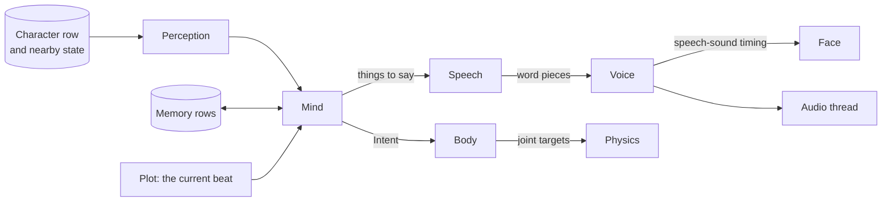

# Spec 3: The networks

This spec defines every network in the game: what it reads, what it writes, its shape and size, and how often it runs. Sizes and shapes are proposed starting points, to be revised by measurement. The code is in [`engine/src/parts/`](../../engine/src/parts), one file per part of the game.

The same networks run for every character at once. What differs between characters is the row of state each one reads.

**Built so far:** perception, mind, speech, body, contact, impulse, step, outcome, director and light exist as tiny stand-ins with random weights (one hidden layer of 16). They have the right input and output types and the right last layers, and they are not trained. Voice, face, input, detail, sound, scene field, form and weather are not built.

## Mechanics

One network holds the rules of the game.

| Network | Reads | Writes | Shape and size | Rate |
| --- | --- | --- | --- | --- |
| Outcome | One event, the two bodies involved, and both parties' Counts rows | Up to 4 Moves | 3 layers of 128; about 50 thousand weights | Once per event, every tick |

An event is either a Contact that involves a character or a held object, or an action a character chose this tick. Picking those rows out of the Contacts table is a filter on flags, not a decision.

The outcome network decides everything that matters: whether the blow got through the armor, how much it hurt, whether the purse changed hands, whether a crime was seen.

## Physics

Four networks and one bounding step advance the physical world.

| Network | Reads | Writes | Shape and size | Rate |
| --- | --- | --- | --- | --- |
| Contact | Two shape codes and their relative pose | Distance, direction and point of nearest approach | 3 layers of 64; about 15 thousand weights | Per nearby pair, each step |
| Impulse | The graph of touching bodies: 16 numbers and 4 vectors per body, the geometry of each contact | An impulse per contact | 3 rounds of message passing; about 100 thousand weights | Each step |
| Detail | A garment or soft part: its pose code and how fast that is changing | Offsets for its surface points | 3 layers of 128; about 200 thousand weights | Every tick, visible characters |
| Sound | Shape code, material code, hit point, impulse | 32 tones, each a pitch, a decay and a loudness | 3 layers of 48; about 30 thousand weights | Once per audible contact |

A step runs in this order.

1. Bodies are sorted by cell so that nearby pairs are found without searching.
2. The contact network gives distance and direction for every nearby pair.
3. Joint targets from the body networks are added as forces, within each joint's strength.
4. The impulse network shares impulses among everything that touches.
5. The bounding step applies them: outside every solid, and no energy gained.
6. Contacts above a small impulse are written to the Contacts table.

The impulse network sees only distances, angles and directions between bodies. Turning or moving the whole scene therefore cannot change the result.

The 32 tones from the sound network are added together as decaying sine waves on the audio thread. Adding them is plumbing. Choosing them is the network.

## Plot

One network runs the story.

| Network | Reads | Writes | Shape and size | Rate |
| --- | --- | --- | --- | --- |
| Director | Story bits, a summary of the facts, summaries of up to 16 nearby characters, the player's recent behavior, its own carried state | A Choice of beat under the allowed mask; a Choice of who plays it among nearby characters; a Choice of place | Small recurrent network with a state of 64; about 150 thousand weights | 2 a second |

"No beat now" is always one of the options, and usually the right one. When a beat is chosen, the commit marks it as happened and applies its fact changes. The chosen characters read it as part of their next perception.

## World

Four networks hold and draw the place.

| Network | Reads | Writes | Shape and size | Rate |
| --- | --- | --- | --- | --- |
| Scene field | The camera and one region's fitted elements | The visible elements, sorted for drawing | Up to a few million elements per region, about 48 bytes each | Every frame |
| Form | A body's shape code, material code and pose | The elements that draw that body | 3 layers of 64; about 30 thousand weights | Every frame, visible bodies |
| Light | An element's 16 features, its facing, the view direction, the region's light state | Color | 3 layers of 32; about 5 thousand weights, run per visible element | Every frame |
| Weather and time | The clock, the region's climate, its own carried state | A light state code of 16, and wind | Small recurrent network; about 20 thousand weights | 1 a second |

The scene field is a fitted model. Its numbers are found by training against images of the region, exactly as weights are, but there is one set per region instead of one for the game.

An element is a small soft blob with a position, a size, an orientation and 16 features. The GPU draws elements directly, back to front. The form network makes moving things out of the same elements, so characters and scenery are lit by the same light network and look like they belong together.

## Characters

Six networks are shared by every character, and a seventh stands in for the player's mind.

| Network | Reads | Writes | Shape and size | Rate |
| --- | --- | --- | --- | --- |
| Perception | Up to 8 nearest things and people, sounds heard, ground samples | A summary of 32 numbers | Attention over 8 items; about 30 thousand weights | Every tick |
| Mind | Perception, a read of memory, the current beat, own Counts, own mind state | Intent with a Choice of 64 actions; up to 8 things to say; a memory row to write; new mind state | Recurrent, 2 layers of 128; about 200 thousand weights | 4 a second |
| Speech | Identity, mood, the things to say, the last word piece, own speech state | A Choice of the next word piece | Recurrent, 6 layers of 384; about 30 million weights | 15 a second per speaker |
| Voice | Word pieces, voice code, mood | Sound at 24 kHz, and the timing of each speech sound | Two stages; about 15 million weights | Every fourth tick per speaker |
| Body | Own joint angles and rates, intent, style code, ground samples | Targets for up to 32 joints, bounded by each joint's limits and strength | 3 layers of 512; about 1.5 million weights | 30 a second |
| Face | Speech-sound timing, mood, identity | 32 face weights | 2 layers of 64; about 50 thousand weights | Every tick |
| Input | Keys, pointer, what is near the player | The player character's Intent | 2 layers of 128; about 40 thousand weights | Every tick |

### Memory

Memory is state, read and written by the mind. Reading is attention over the character's own 16 rows. Writing replaces the row with the lowest weight. Weights fade a little every tick, so what mattered most lasts longest.

### How names and facts get into speech

The speech network's vocabulary is 4,096 word pieces of this world's language, plus 8 slots. The mind fills the slots with references: to a person, a place, an item, a fact. The speech network can choose a slot but cannot invent what is in it. When the words are voiced, each slot is read out from the state.

So a character can only name what the mind chose to mention, and the mind can only choose from what the character perceives or remembers.

### Rumor

When one character speaks to another, the listener perceives the speaker's slots as things told. The listener's mind may write them to memory at a lower weight. That is the whole mechanism of rumor.

### The player

The player is a character whose mind is a person. The input network turns raw input and context into the same Intent type a mind network produces. Nothing downstream can tell the difference.

## How each network is judged

Every network has one headline measure, taken on situations it was not trained on.

| Network | Judged by |
| --- | --- |
| Outcome | Share of events where its moves equal the rules simulator's |
| Contact, impulse | Position error after one second against the exact solver. Overlap must be zero and energy must never rise without work |
| Sound | How close its pitches are to the vibration solver's |
| Director | Agreement with the teacher's ranking of beats |
| Scene field, form, light | Difference from reference images at viewpoints not used in fitting |
| Mind | Agreement with the teacher's chosen action |
| Speech | A large model's grade for sense and for being in character. The flip-a-fact test must find nothing |
| Voice | Word errors when a speech recognizer listens, plus listener ratings |
| Body | Error against motion capture, and falls per minute under shoves |
| All together | How much recorded play changes between one round of joint training and the next |
