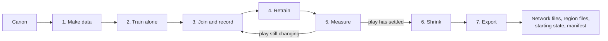

# Spec 4: The factory

This spec defines how a designer's canon becomes trained networks: the input files, the data made for each part, the training stages, and the files that come out. None of the factory is built yet.

The loop is the important part. Networks are joined, recorded and retrained until a round of play looks the same as the round before.

## Canon: what the designer writes

Canon is six kinds of file. It is the only hand-made input, and none of it runs in the game.

| File | Holds |
| --- | --- |
| World | Regions, places, how they connect, climate |
| Cast | One card per character: who they are, what they want, how they speak, how they move, who they know |
| Rules | The game's rules in a small declarative form the rules simulator can run: actions, costs, effects |
| Story | Beats: the facts each requires, the facts each changes, and a short account of what should happen |
| Look and sound | Reference images, scans, voice samples, motion clips |
| Lexicon | The world's vocabulary and names. It fixes the 4,096 word pieces |

A character's identity, voice and style codes are not written by hand. Each character starts with blank codes, and training the shared networks on that character's data fills them in.

## Training data for each part

Each part gets data from the best teacher for its job. The amounts are proposed starting points and will change with measurement.

| Part | How the data is made | Starting amount |
| --- | --- | --- |
| Mechanics | The rules simulator run over random events drawn from the rule set | 10 million events |
| Physics | Random scenes of clutter and jointed bodies, solved exactly at tiny time steps | 1 million one-second scenes |
| Plot | Simulated play-throughs scored by a large model and by the designer | 10 thousand play-throughs |
| World | Reference images of each region from many viewpoints and light states | A few thousand images a region |
| Characters: mind and speech | A large model plays each character from its card across generated situations, with facts flipped at random | 5 million exchanges across the cast |
| Characters: voice | Recorded speech, plus a large speech model voicing lines in each character's described voice | 100 hours |
| Characters: body | Motion capture, then trial and error inside the physics network | 20 hours of motion |

Flipping facts at random in the speech data matters. It teaches the speech network that facts come from the slots it is handed, never from habit.

## Training stages

Training runs in seven stages, with stages 3 to 5 repeated.

1. **Make data.** Teachers produce the data above.
2. **Train alone.** Each network is trained against its teacher's outputs.
3. **Join and record.** The whole game runs headless with every network in place and the recorder on. Stand-in players drive it.
4. **Retrain.** Each network's recorded inputs are shown to its teacher, which says what it would have output. The network is retrained on those pairs, so it learns to cope with what its neighbors really send.
5. **Measure.** Each network gets its score from [Spec 3](spec-3-the-networks.md), and the round's recordings are compared with the last round's.
6. **Shrink.** Weights are reduced to 16-bit, and to 8-bit where the score does not drop.
7. **Export.** Network files, region files, the starting state and the manifest are written.

Body and physics are trained together from stage 3 on, over many ticks in a row, because each feeds the other.

## Exported files

The factory writes four kinds of file. Together they are the game.

| File | Layout |
| --- | --- |
| Network file | A header with name, version, part, input and output type fingerprints, the list of layers with their sizes, and the number format. Then the weights, aligned to 4 bytes |
| Region file | A header with bounds and element count. Then the fitted elements |
| Starting state | The six state tables in their schema layout, including every character's codes |
| Manifest | Every file with its size, hash and load order, and the type fingerprints of the build it fits |

The runtime loads nothing that is not in the manifest, and refuses any file whose fingerprints do not match.
