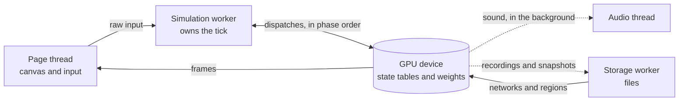

# Spec 5: Browser runtime

This spec defines how the game runs in Chrome: the threads, the loading order, the GPU resources, and what happens when something fails. Today the code runs the tick on the page thread on the CPU and only checks that every network compiles on the GPU ([`engine/src/gpu.ts`](../../engine/src/gpu.ts)). Everything below is the target.

During play the state never leaves the GPU. Only sound, recordings and snapshots are copied out, and nothing waits for them.

## Modules and threads

The game is four threads around one GPU device.

| Thread | Owns | Does |
| --- | --- | --- |
| Page thread | The canvas and input devices | Forwards raw input. Shows frames. Runs no game logic |
| Simulation worker | The GPU device and the tick | Issues every network's dispatch in phase order, the commit and the draw |
| Audio thread | The sound output | Mixes voice audio and impact tones from a shared ring |
| Storage worker | Files | Loads networks and regions, writes recordings and saves |

The commit also runs on the GPU. Sorting moves and applying them is done in compute, so no state has to come back to the CPU mid-tick.

Three things are copied out of the GPU, all in the background.

- **Sound.** The voice network writes audio about a tenth of a second ahead of when it is heard. Impact tones arrive one or two frames after the contact.
- **Recordings.** The recorder's ring is copied out only while a recording session is on.
- **Snapshots.** The state tables are copied out every 30 seconds and whenever the tab is hidden.

## Loading sequence

Loading is eight steps, and compiling overlaps downloading so neither waits for the other.

1. Fetch the manifest.
2. Ask the GPU for a device, with the limits and optional features listed below. Choose 16-bit weights if half-precision is granted, 32-bit otherwise.
3. Check the manifest's type fingerprints against the build. Stop with a clear message on a mismatch.
4. Create both copies of the six state tables, and a buffer for each network's weights.
5. Compile every network's pipeline in the background while the network files download.
6. Load the starting state, or the latest save.
7. Load the first region.
8. Start ticking. Other regions stream in as the player approaches them.

On a repeat visit everything comes from the browser's cache. A reasonable target is play within ten seconds. It is a target, not a measurement.

## GPU resources and limits

The plan fits inside WebGPU's default limits wherever it can. Sizes follow from the capacities in [Spec 1](spec-1-types-and-state.md) and the network sizes in [Spec 3](spec-3-the-networks.md).

| Resource | Plan |
| --- | --- |
| Body table | 16,384 rows of about 200 bytes: about 3 MB a copy |
| Character table | 1,024 rows of about 6.6 KB, mostly speech state and memory: about 7 MB a copy |
| Other state tables | Under 2 MB together |
| Network weights | One read-only buffer per network. The largest is speech: 30 million weights, 60 MB at 16-bit |
| A region | Up to about 5 million elements in one buffer at 48 bytes each. Larger regions are split into tiles |
| Bindings per network | At most 8 buffers: inputs, outputs, weights and a mask |

WebGPU guarantees 256 MB per buffer without asking, and every buffer above fits. The default limit of 8 storage buffers per shader stage is a remembered figure, and it is why each network binds at most 8. Confirm both on the target machines.

Optional features to request at start-up:

- `shader-f16` for half-precision weights.
- `subgroups` to let neighbouring shader threads share work in the larger networks.
- `timestamp-query` to time each phase against its budget while the game runs.

## Storage, saves and failure handling

Files are cached by their hash, and the game can always recover to its last snapshot.

- **Network and region files.** Stored in the browser's cache, keyed by the hash in the manifest. A changed file has a new hash, so nothing stale is ever loaded.
- **Saves and recordings.** Stored in the browser's private file storage. The game asks the browser to keep that storage from being cleared.
- **A lost GPU device.** Create a new device, reload weights from the cache, restore the last snapshot and resume. The player loses at most 30 seconds.
- **Not enough memory for a region.** Load it as smaller tiles and draw at a lower internal resolution.
- **A hidden tab.** Take a snapshot and stop ticking until the tab is shown again.
- **A type mismatch.** Refuse to start and say which file and which type disagree. This should only ever happen to a developer.
